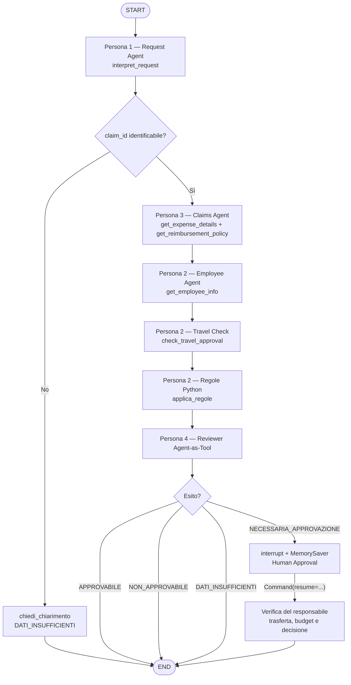

# Architettura del sistema (LangGraph) — dati originali del gruppo

**Dati letti (mai modificati)**: `data/employees.json`, `data/claims.json`, `data/policies.json`, `data/README.json`. I primi tre contengono, rispettivamente, 3 dipendenti, 4 note spese e 4 policy. La fonte non contiene date delle spese, approvazioni trasferta né spesa annuale già sostenuta.

## Perché la Persona 3 precede la Persona 2 nell'esecuzione?
Le **responsabilità** rimangono quelle concordate (Persona 1 Request, Persona 2 Employee/regole, Persona 3 Claims, Persona 4 Reviewer/supervisor). Ma la nota spese contiene `employee_id`, quindi recuperarla prima consente di controllare il titolare effettivo invece di fidarsi di un identificativo digitato nel messaggio.

## Semantica di policy e decisioni
- `max_amount`: massimale vincolante; se una spesa lo supera: `NON_APPROVABILE`.
- `approval_over`: soglia di Human Approval **solo quando l'importo non supera il massimale**. Nei dati attuali tutte le soglie coincidono con i massimali e quindi non creano un caso aggiuntivo.
- `receipt_required`: se vero e `receipt_id` manca: `DATI_INSUFFICIENTI` (si chiede un giustificativo senza inventarlo).
- `allowed_roles`: se il ruolo non è incluso: `NON_APPROVABILE`.
- `annual_expense_limit`: non è il residuo annuo; per autorizzare il pagamento serve una verifica manuale del budget disponibile.
- Approvazione trasferta: i JSON **non** contengono dati per verificarla, quindi `check_travel_approval` restituisce `NOT_AVAILABLE`. Quando gli altri controlli sono superati, il workflow emette `NECESSARIA_APPROVAZIONE` e si sospende per l'operatore. `False` verificato è ben diverso da `None` assente.

## Interruzione e ripresa
`MemorySaver` memorizza lo stato del thread; `interrupt(...)` ferma il nodo `human_approval`. Un responsabile (esterno alla demo e non autenticato dal notebook) può rispondere con i campi `approva`, `trasferta_approvata` e `budget_disponibile_verificato`. La chiamata a `Command(resume=...)`, con lo **stesso** `thread_id`, completa la valutazione.

**Limiti espliciti:** `MemorySaver` è volatile; mancano integrazione a database approvazioni, verifica materiale delle ricevute, saldo annuo, controllo accessi del manager e audit persistente. Senza documentazione reale del responsabile, una risposta di test non deve essere considerata un'autorizzazione aziendale.
